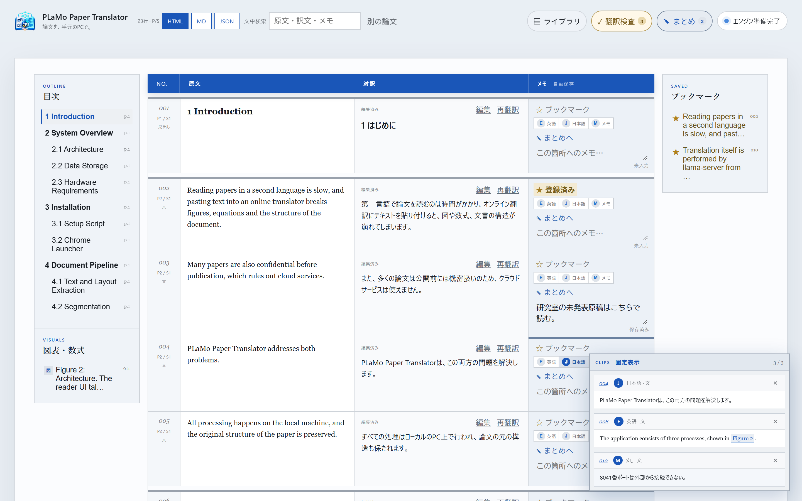

# PLaMo Paper Translator

PLaMo 3 Translate をこのPC上で動かし、PDF論文を一文単位の対訳にするローカルアプリです。論文の内容を外部へ送らずに翻訳できます。

- 原文・訳文・箇所別メモを一文ずつ並べて表示。番号付き数式は画像のまま、本文中の下付き・上付き文字も保持します。
- 小節構造から生成した目次、「Figure 2」などの参照リンク、ブックマーク、固定クリップで論文の中を行き来できます。
- 読みながら書けるまとめパネル（Markdown・数式・図の埋め込み）と、翻訳の機械チェック、横断検索できる論文ライブラリ。
- 結果はHTML / Markdown / JSON へ保存。Chrome拡張のボタン（`Alt + Shift + P`）からも起動できます。

> Built with PLaMo. モデル本体はリポジトリに同梱せず、初回セットアップ時にPFNの公式配布元から取得します。



## まず試す

デモ動画（約70秒）：[論文PDFを手元のPCだけで対訳に｜PLaMo Paper Translator デモ](https://www.youtube.com/watch?v=pXtkL5Bdif4)

インストール後、同梱の [`docs/manual/manual.pdf`](docs/manual/manual.pdf) を読み込んでみてください。このアプリのマニュアルを英語の論文形式（二段組み）で書いたPDFで、図・表・番号付き数式・参考文献・付録を含みます。同じ内容の一段組み版 [`docs/manual/manual-onecolumn.pdf`](docs/manual/manual-onecolumn.pdf) もあります。CC0（パブリックドメイン）なので、翻訳結果を動画や記事に載せる場合も原文側のクレジットは不要です（翻訳結果には `Built with PLaMo` の表示が必要です）。

## English

PLaMo Paper Translator turns an academic PDF into a sentence-aligned bilingual document on your own PC. Translation runs locally with PLaMo 3 Translate and llama.cpp, so the paper never leaves your machine. Figures and numbered equations are kept as images, subscripts and superscripts are preserved, and the reader offers an outline, cross-reference links, bookmarks, pinned clips, a Markdown summary panel with math, a quality check and a searchable library. Results can be exported to HTML, Markdown or JSON.

- **Demo video (about 70 s):** [Read Academic PDFs Side by Side, Fully Offline](https://www.youtube.com/watch?v=3HeDeQIU8pc)
- **Requirements:** Windows. An NVIDIA GPU is recommended (developed on an RTX 2000 Ada laptop GPU with 16 GB); without one, the Vulkan build of llama.cpp is used. The default 8B model file is about 5.3 GB; a 2B model (1.8 GB) is available for smaller GPUs.
- **Quick start:** run `Start-PLaMoPaperTranslator.cmd`, read and accept the PLaMo Community License summary, and the setup script downloads llama.cpp and the model from the official sources. The reader opens at `http://127.0.0.1:7865`.
- **Try it:** load [`docs/manual/manual.pdf`](docs/manual/manual.pdf), the app's own user manual written as a paper (CC0).
- **Languages:** the user interface is in Japanese. Source and target languages include English, Japanese, Chinese, Korean, German and French.
- **License:** the app's code is MIT. The model is under the [PLaMo Community License](https://plamo.preferredai.jp/info/plamo-community-license-ja); translations you publish must show "Built with PLaMo". Commercial use, including use inside an organisation, has its own conditions.

## このPC向けの構成

- GPU: NVIDIA RTX 2000 Ada Generation Laptop GPU、VRAM 16GB
- 推奨モデル: `pfnet/plamo-3-translate-8b-GGUF` の `Q4_K_M`（5.28GB）
- 推論: llama.cpp Windows CUDA版
- 文脈長: 16,384トークン
- UI: `127.0.0.1` のみに公開するローカルWeb UI

31B Q4_K_M は約19.53GBでVRAM容量を超えるため既定にはしていません。8Bで重い場合は `setup.ps1 -ModelSize 2b` を使うと、1.81GBの2Bモデルに切り替えられます。

## 最初の起動

1. `Start-PLaMoPaperTranslator.cmd` をダブルクリックします。
2. 初回はライセンスの要点と公式URLが表示されます。内容を確認して `yes` と入力します。
3. llama.cpp、PLaMo 3 Translate 8B、PDF処理ライブラリが取得されます（合計約6GB）。
4. セットアップ後、もう一度 `Start-PLaMoPaperTranslator.cmd` を開きます。
5. ブラウザで `http://127.0.0.1:7865` が開きます。

PowerShellから明示的に実行する場合:

```powershell
Set-ExecutionPolicy -Scope Process Bypass
.\setup.ps1 -ModelSize 8b
.\start.ps1
```

## Chromeからワンクリックで起動

ポータブル版にはManifest V3のChromeランチャーを同梱しています。初回だけ次の設定を行うと、拡張アイコンまたは `Alt + Shift + P` で、アプリを再起動して画面を開けます。停止中ならバックグラウンドで起動し、起動中なら終了させてから起動し直すため、exeやモデルを入れ替えた後も最新の状態で開きます。翻訳中・再翻訳中は作業を失わないよう再起動せず、そのまま画面を開きます。既存タブがあれば新しいタブは増やさず、そのタブを前面へ移して読み込み直します。

1. Chromeで `chrome://extensions` を開き、「デベロッパー モード」を有効にします。
2. 「パッケージ化されていない拡張機能を読み込む」を押し、配布フォルダー内の `chrome-extension` を選びます。
3. `chrome-extension\install-native-host.ps1` を右クリックして「PowerShellで実行」します。
4. アドレスバーで `chrome://restart` を開き、Chromeを再起動します。
5. `PLaMo Paper Translator Launcher` をツールバーへピン留めします。

通常の登録に管理者権限は不要です。`Specified native messaging host not found.` が続く場合のPC全体登録、移動・更新後の再登録、解除方法は [`chrome-extension/README.md`](chrome-extension/README.md) を参照してください。エラー画面は自動更新されないため、登録後は古いエラータブを閉じて拡張アイコンをもう一度押します。

## モデルの取得

### 推奨: セットアップスクリプトで取得

PowerShellをプロジェクトフォルダで開き、次を実行します。

```powershell
Set-ExecutionPolicy -Scope Process Bypass
.\setup.ps1 -ModelSize 8b
```

スクリプトは次の処理を行います。

1. PLaMo Community Licenseと公式モデルURLを表示し、同意を確認します。
2. `.venv/` を作り、`pypdf`、図処理用の `Pillow`、数式画像化用の `pypdfium2 / PDFium` をインストールします。
3. NVIDIA GPUがあればllama.cppのWindows CUDA 12.4版、なければVulkan版を公式GitHub Releasesから取得します。
4. PFN公式Hugging Faceからモデルとチャットテンプレートを取得します。
5. GGUFヘッダー、ファイルサイズ、SHA-256をHugging Face公式APIの現在値と照合します。

既定の8Bモデル:

| 項目 | 値 |
|---|---|
| リポジトリ | `pfnet/plamo-3-translate-8b-GGUF` |
| ファイル | `plamo-3-translate-8b-Q4_K_M.gguf` |
| サイズ | 5,280,445,728 bytes（約5.28GB、2026-11-08時点） |
| SHA-256 | `94e5d3f91b421f7c8900ddaac27b11a19f7441426c954bbb25a2fd60a1640187`（同日時点） |
| 保存先 | `models/plamo-3-translate-8b-Q4_K_M.gguf` |
| 追加ファイル | `models/chat_template.jinja` |

途中で通信が切れた場合は、同じコマンドをもう一度実行してください。`.partial` ファイルから再開します。完成済みファイルは再取得しません。

### 軽量な2Bモデルを使う

VRAMが少ないPCや速度を優先する場合:

```powershell
.\setup.ps1 -ModelSize 2b
```

取得するファイルは `plamo-3-translate-2b-Q4_K_M.gguf`（1,807,203,040 bytes、約1.81GB、2026-11-08時点）です。8Bと2Bを両方置いた場合、アプリはファイル名順で最初に見つかったGGUFを使うため、使用しない方を `models/` の外へ移してください。

### モデルだけ手動で取得

llama.cppとPython環境を既に準備済みの場合は、公式URLからモデルだけ取得できます。

```powershell
New-Item -ItemType Directory -Force .\models | Out-Null

curl.exe -L --fail --retry 4 -C - `
  -o .\models\plamo-3-translate-8b-Q4_K_M.gguf.partial `
  "https://huggingface.co/pfnet/plamo-3-translate-8b-GGUF/resolve/main/plamo-3-translate-8b-Q4_K_M.gguf?download=true"

if ($LASTEXITCODE -ne 0) {
  throw "モデルのダウンロードに失敗しました。同じコマンドで再開してください。"
}

Move-Item `
  .\models\plamo-3-translate-8b-Q4_K_M.gguf.partial `
  .\models\plamo-3-translate-8b-Q4_K_M.gguf

curl.exe -L --fail --retry 4 `
  -o .\models\chat_template.jinja `
  "https://huggingface.co/pfnet/plamo-3-translate-8b-GGUF/resolve/main/chat_template.jinja?download=true"
```

取得後の確認:

```powershell
Get-Item .\models\*.gguf | Select-Object Name, Length
Get-ChildItem .\runtime -Filter llama-server.exe -Recurse
nvidia-smi
```

### モデル取得時の注意

- 空き容量は8B構成で最低10GB、ビルド成果物も作る場合は15GB以上を推奨します。
- モデルはGit管理対象外です。`.gitignore` により `.gguf`、ランタイム、論文、翻訳結果はpushされません。
- プロキシ環境では `HTTPS_PROXY` を設定してから `setup.ps1` を再実行してください。
- 組織内利用はPLaMo Community License上の商業目的に含まれます。該当する場合はPFNの条件に従って事前登録または契約を行ってください。
- 取得元を変更した非公式GGUFは、テンプレートや量子化方式が異なる可能性があるためサポート対象外です。

## 使い方

1. PDF / TXT / Markdown をドロップします。
   ファイル名または冒頭本文にarXiv ID／DOIがあれば、「原文URL / DOI」へ対応URLを自動入力します。検出はローカルで行い、外部通信はしません。
2. 分割モード（`一文単位` または `段落単位`）、原文と翻訳先の言語、日本語の文体を選びます。
3. 必要なら参考文脈と用語集を入力します。用語集は `原語 = 訳語` を1行ずつ書きます。
4. 「翻訳を開始」を押します。
5. 完了後、左の原文、中央の訳文、右のメモを選択した単位で確認します。一文単位では各行の `P段落番号 / S文番号` と太い区切りで段落境界も確認できます。左側の目次から節・小節へ移動でき、その下の「図表・数式」一覧または英語・日本語の図・式・表の参照リンクから対応セグメントへ移動できます。移動後は固定上部バーの「戻る」で参照元へ戻れます。各メモ欄の☆でブックマーク、`E 英語`・`J 日本語`・`M メモ`で選んだ内容だけを最大3件まで画面右下へ固定できます。メモ・ブックマーク・クリップは自動保存されます。
   訳文上部の「編集」からそのセグメントだけを校正でき、「再翻訳」は同じ段落の前後文・参考文脈・用語集を再利用して1件だけモデルへ送り直します。変更前の訳文は最大20版まで保持され、「履歴」から確認・復元できます。画像化された数式は原文画像を正本とするため編集・再翻訳の対象外です。
6. 固定上部バーから対訳の検索とHTML / Markdown / JSON保存を行えます。「まとめ」を押すと画面右端にまとめパネルが開き、本文を読みながら論文全体のタグ（最大20件）と概要を書けます。パネルを開いている間は本文の幅が縮み、パネル左端のドラッグ（または矢印キー）で幅を変えられます。概要はMarkdownで書け、`$…$` と `$$…$$` の数式はKaTeX（同梱、オフラインで動作）で表示します。「図2」「式(4)」「表1」と書くと本文の該当箇所へのリンクになり、`![[図2]]` や `![[式4]]` で図・数式の画像を埋め込めます。各行の「まとめへ」を押すと、その行の訳文を引用として（図・数式は画像の埋め込みとして）挿入します。「編集」と「表示」で書く画面と仕上がりを切り替え、編集中は数式や参照を含む段落だけを下にプレビューします。「研究ノート雛形」は研究課題・手法・実験条件・結果・新規性・限界・次に確認することの見出しを挿入します。タグと概要は入力後に自動保存され、再読み込み後も復元されます。まとめ（タグ・原文URL・読書状態・概要）はHTML / Markdown / JSONのすべての出力の先頭に入ります。HTMLではアプリと同じ表示になり、`図2` などの参照は同じファイル内の該当行へのリンクに、`![[図2]]` は図の画像になります。数式を含む場合だけKaTeXとそのフォントをファイルに埋め込むため、約0.8MB大きくなります。Markdownでは `![[図2]]` を画像リンクに、`[[#12]]` を行番号に置き換え、`$…$` の数式はそのまま残します。HTMLは図とメモを埋め込んだ単体ファイルで、各形式に `Built with PLaMo` と生成元モデルを記録します。
   「翻訳検査」は未翻訳、原文と同一の訳、欠落した数値・単位、極端に短い訳、用語集の訳語漏れを機械的に確認し、結果から該当セグメントへ移動できます。これは投稿前の人手校正を置き換えるものではありません。

上部の「ライブラリ」では、保存済みの論文を一覧表示し、前回読んでいたセグメントから再開できます。タイトル・タグ・概要・原文・訳文・メモを横断検索でき、未読・読書中・読了・保留で絞り込めます。同じPDFをもう一度読み込んだ場合は既存翻訳へのリンクを表示します。各カードの「削除」は確認ダイアログのあとで訳文・メモ・まとめを削除し、元ファイルと抽出画像もほかの翻訳で使っていなければ削除します。翻訳中の論文は削除できません。各カードの「再抽出」は、保存済みの論文を最新の抽出処理で読み直します。アプリの更新で図や数式の抽出が改善されたときに使います。本文が変わらない行の訳文、メモ、ブックマーク、クリップ、まとめの行参照はそのまま引き継ぎ、新しい行・変わった行だけを翻訳し直します。変わった行のメモは最も近い行へ移し、手で直した訳文は訳文の履歴に残ります。実行前の状態は `data/reextract-backups/` に保存されます。「ZIPバックアップ」はジョブ、元ファイル、抽出画像をまとめて保存し、「ZIPから復元」は既存ファイルを上書きせず新規データだけを取り込みます。ライブラリの保存先は画面内にも表示され、通常版はプロジェクトの `data/`、ポータブル版はランチャー設定で指定されたアプリホームの `data/` です。`Alt + L` でライブラリ、`Alt + S` で現在の論文のまとめパネルを開閉できます。

公開動画やWeb記事に使いやすいCC BY 4.0論文の候補と、投稿時のクレジット例は [`docs/PUBLIC_DEMO_PAPERS.md`](docs/PUBLIC_DEMO_PAPERS.md) にまとめています。

一文単位モードは論文を一文ずつ分割し、翻訳時に同じ段落の前後文を参考文脈として付与します。段落単位モードは同じ段落の文をまとめてモデルへ渡します。どちらも見出し、数式、表、図キャプション、箇条書きを構造ブロックとして保持します。番号付きの独立数式はPDFの該当領域を高解像度画像として表示し、抽出テキストも検索・コピー用に折りたたんで保持します。図はPDFページ上の実表示領域をレンダリングして切り出すため、埋め込み画像とは別に重ねられた `(a)(b)(c)`、数式記号、注釈も保持します。`REFERENCES` 以降は著者・年・題名・掲載誌を1件の引用単位にまとめ、各ページで反復するヘッダーとフッターは本文から除外します。PLaMo公式の `chat_template_kwargs` を使って `target_lang`、`source_lang`、`context`、`glossary`、`form` をモデルへ渡します。

閲覧画面はA4や元PDFのページ境界に合わせず、PCとタブレットの横幅を使う研究リーダー形式です。PCでは階層目次を本文の左側、ブックマーク一覧を右側に固定し（まとめパネルを開いている間はブックマーク一覧が目次の下へ移ります）、現在読んでいる節を目次上で追跡します。`Fig./Figure/図`、`Eq./Equation/式`、`Table/表` の番号付き参照は、同じ番号の候補のうち実画像が付いたセグメントを優先してリンクします。図番号と画像が別行に分かれたPDFでは、同じページ・段落付近の画像付き行を図番号へ関連付けます。図・数式が本文で初めて参照された時点より後ろにある場合は、閲覧画面上で画像付きセグメントを初回参照の直後へ配置します。参照ジャンプは最大20回分の戻り履歴を保持します。クリップした英語・日本語・メモは、選択した内容だけを画面右下に常時表示します。図・数式の英語または日本語をクリップした場合は対応する画像も一緒に表示します。タブレットでは目次とブックマーク一覧が本文上部へ移り、さらに狭い画面では原文・訳文の下へメモ欄が回り込みます。クリップ状態は保存ジョブから再読み込み時に復元され、JSON出力にも含まれます。

本文・参考文献内の `https://...`、DOI、arXiv IDは外部リンクとして表示されます。クリックすると原文情報を新しいタブで開きます。

## 対応範囲と制約

- テキストを内包するPDFに対応します。画像だけのスキャンPDFは、先にOCRしてください（読み込み時にその旨を表示します）。
- 日本語・中国語・韓国語の論文にも対応します。文字の対応表を持たないフォント（LaTeXで作られた日本語論文に多い）は、Adobeの公開文字表で読み取ります。「図 1:」「表 2」のキャプションも認識します。日本語論文の数式の画像化は、英語論文ほどには認識しません。
- 二段組みはPDF内部の読み順に沿って抽出します。複雑な脚注や数式の文字表現はPDFの内部構造に依存します。
- PDFに埋め込まれたラスター図は抽出して図キャプション付近へ配置します。線や図形だけで描かれた図（グラフ、フローチャート、模式図）は、キャプションの上の領域をページから切り出して画像にします。図の中の文字（「(a) (b)」、凡例、目盛りなど）は図の画像に含まれるため、本文からは外します。画像化されていない表は原文テキストとして保持されます。
- 番号付きの独立数式は216dpi相当のPNGとして切り出します。インライン数式と画像化できない数式は抽出テキストへフォールバックします。
- 本文中の下付き・上付き文字は、PDF上の文字の大きさと位置から認識し、`E_{algo}`・`b^{⋆}` の形で保持して画面とHTML / Markdown出力では下付き・上付きで表示します（JSONはこの記法のまま）。PLaMoはこの記法を保ったまま訳します。分数の分子・分母や総和の上下の添字など、本文の行と高さがずれた文字も同じ記法になります。抽出処理の改善は読み込み済みの論文には自動では反映されません。ライブラリの「再抽出」で、訳文やメモを残したまま読み直せます。
- 翻訳は機械生成です。投稿・契約・医療判断などに使う場合は、専門家による校正が必要です。
- 初回ダウンロード後の翻訳はオフラインで動作します。
- 論文と結果は `data/`、モデルは `models/`、推論ランタイムは `runtime/` に保存されます。

## データを消す

論文ごとに消す場合は、ライブラリの各カードの「削除」を使います。すべて消す場合は、アプリを終了してから `data/uploads/`、`data/jobs/`、`data/assets/`、`data/reextract-backups/` の中身を削除してください。モデルも削除する場合は `models/` の `.gguf` を削除します。再度 `setup.ps1` を実行すれば取得できます。

## 開発時のテスト

リポジトリのルートで実行します。抽出処理のテストには、同梱の論文形式マニュアル [`docs/manual/manual.pdf`](docs/manual/manual.pdf) を使う回帰テストも含まれます。

```powershell
.venv\Scripts\python.exe -m unittest discover -s tests
# まとめのMarkdown表示（Node.jsが必要）
node --test tests/markdown.test.js
```

UIや `static/` を変更した場合、ポータブル版のexeには同梱ファイルが埋め込まれているため、`build-portable.ps1` で作り直すまで反映されません。

## 配布物を作る

開発PCで次を実行すると、Pythonを同梱したモデル非同梱のポータブルZIPが `dist/` に作られます。

```powershell
.\build-portable.ps1
```

モデルはPLaMo Community Licenseの確認と公式配布元からの取得を受取人ごとに行う設計です。ポータブルZIPにはアプリのMIT Licenseと、同梱するPython・pypdf・Pillow・pypdfium2/PDFium・KaTeX・Adobe CMap・PyInstallerのライセンス本文を収録します。詳しい配布方式の比較は `DISTRIBUTION.md` を参照してください。

## ライセンス

アプリ独自コードはMIT Licenseです。外部コンポーネントにはそれぞれのライセンスが適用されます。

- PLaMo Community License（日本語）: https://plamo.preferredai.jp/info/plamo-community-license-ja
- PLaMo 3 Translate 8B GGUF: https://huggingface.co/pfnet/plamo-3-translate-8b-GGUF
- llama.cpp: https://github.com/ggml-org/llama.cpp
- pypdf: https://pypdf.readthedocs.io/
- Pillow: https://python-pillow.org/
- pypdfium2 / PDFium: https://github.com/pypdfium2-team/pypdfium2
- KaTeX: https://katex.org/
- Adobe CMap resources: https://github.com/adobe-type-tools/mapping-resources-pdf

生成物を第三者へ提供・公表する場合は、`Built with PLaMo`、生成元の明示、ライセンスの提供など、PLaMo Community License第4条・第5条の条件を確認してください。組織内利用を含む商業目的では、直近事業年度の収入または売上が10億円以下でも事前登録が必要で、超える場合はPFNから別途商業用ライセンスを取得する必要があります。
